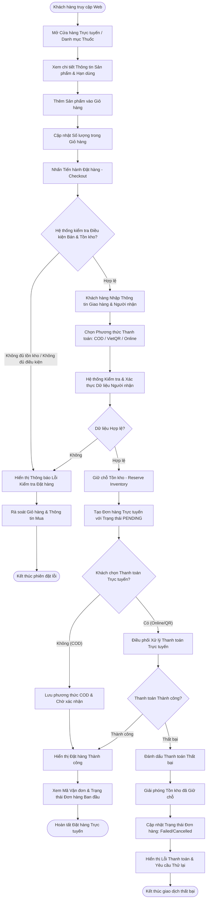

# ĐẶC TẢ LUỒNG HOẠT ĐỘNG SWL 2.1: ĐẶT HÀNG TRỰC TUYẾN & THANH TOÁN
## (ONLINE SHOPPING & CHECKOUT WORKFLOW)

> **Dự án:** PharmaFlow — Hệ thống Quản lý Kho & Bán hàng Thông minh cho Nhà thuốc Tư nhân  
> **Mã luồng:** `SWL-2.1` | **Mã tiến trình Draw.io:** `swl 2.1` (Online Store & Checkout)  
> **Phân hệ:** Khách hàng (Customer Web Portal) & Cổng Dịch vụ Thanh toán  
> **Mã tài liệu:** `02_Requirement/7mainflow/Description SWL 1.md`  
> **Phiên bản:** v1.0 | **Ngày ban hành:** 13/10/2026  

---

## 1. TỔNG QUAN NGHIỆP VỤ (BUSINESS OVERVIEW)

### 1.1. Mục tiêu & Ý nghĩa
Luồng **SWL 2.1** quản lý toàn bộ trải nghiệm mua sắm dược phẩm của khách hàng trên kênh thương mại điện tử (Web Storefront): từ khi tìm kiếm thông tin thuốc, thêm vào giỏ hàng, xác định tính hợp lệ của thuốc (Rx/OTC), đặt giữ tồn kho tạm thời (Inventory Reservation), xác thực thông tin giao hàng, cho đến thanh toán trực tuyến hoặc chọn trả tiền khi nhận hàng (COD).

### 1.2. Phạm vi & Tác nhân tham gia
- **Khách hàng (Customer):** Người dùng duyệt sản phẩm, cập nhật số lượng giỏ hàng, nhập địa chỉ nhận hàng, chọn phương thức thanh toán.
- **Hệ thống PharmaFlow (System):** Kiểm tra điều kiện bán (Sale eligibility), xác thực tồn kho khả dụng, giữ chỗ tồn kho (Reserve Inventory), tạo đơn hàng trạng thái `PENDING`, điều phối cổng thanh toán.
- **Cổng thanh toán / VietQR (External Payment):** Xử lý giao dịch thanh toán trực tuyến khi được kích hoạt.

### 1.3. Căn cứ pháp lý & Quy tắc nghiệp vụ (Business Rules)
- **BR07 / BR13 (Kiểm soát Thuốc kê đơn Rx):** Cảnh báo khách hàng về thuốc kê đơn, yêu cầu chuẩn bị đơn thuốc của bác sĩ; thuốc kê đơn không được giao nhận nếu thiếu đơn thuốc hợp lệ.
- **BR14 (Phương thức thanh toán):** Bắt buộc chọn phương thức thanh toán hợp lệ (`COD`, `VIETQR`, `VNPAY`).
- **BR16 (Cấm tồn kho âm):** Hệ thống chỉ cho phép đặt hàng khi `available_quantity >= requested_quantity`.
- **BR23 (Đơn vị tính cơ sở):** Quy đổi số lượng đặt hàng về đơn vị nhỏ nhất để kiểm tra và giữ tồn kho.
- **BR30 (Cấm khuyến mãi thuốc kê đơn):** Không áp dụng voucher/chiết khấu đối với sản phẩm có gắn cờ `Rx_Flag = TRUE`.

---

## 2. SƠ ĐỒ TIẾN TRÌNH HOẠT ĐỘNG (WORKFLOW DIAGRAM)

*Sơ đồ ánh xạ trực tiếp từ trang `swl 2.1` trong tệp thiết kế `pharma.drawio`:*

---

## 3. BẢNG KỊCH BẢN THỰC THI TỪNG BƯỚC (STEP-BY-STEP SCENARIO TABLE)

| Bước | Tác nhân | Hành động & Thao tác Giao diện | Xử lý Hệ thống & Logic Backend | Ràng buộc (BR) | Kết quả đầu ra |
|:---:|:---|:---|:---|:---:|:---|
| **1** | Khách hàng | Truy cập `home.jsp` hoặc `products.jsp`, duyệt qua danh mục phân loại | `ProductServlet` (GET): Nạp danh sách sản phẩm đang hoạt động (`status = 'HOAT_DONG'`) kèm giá bán lẻ | BR07 | Hiển thị danh mục thuốc có ảnh, tên, dạng bào chế, giá bán |
| **2** | Khách hàng | Chọn sản phẩm, vào `product-detail.jsp` xem chi tiết hoạt chất, hàm lượng, quy cách đóng gói | Kiểm tra cờ `rx_flag`. Nếu thuốc kê đơn, hiển thị badge cảnh báo "Thuốc kê đơn - Cần đơn bác sĩ" | BR07, BR13 | Khách nắm rõ thông tin sản phẩm và điều kiện mua |
| **3** | Khách hàng | Chọn đơn vị bán (Hộp/Vỉ/Viên), nhập số lượng và nhấn **"Thêm vào giỏ hàng"** | `CartServlet` (action `add`): Tính toán `base_quantity` theo đơn vị chọn, lưu vào giỏ hàng (Session/Cookie/DB) | BR23, BR16 | Giỏ hàng cập nhật số lượng; cập nhật badge giỏ hàng góc phải |
| **4** | Khách hàng | Mở `customer/cart.jsp`, tăng/giảm số lượng hoặc xóa mặt hàng | `CartServlet` (action `update` / `delete`): Kiểm tra lại số lượng tồn khả dụng `available_quantity` của SKU | BR16 | Tổng tiền giỏ hàng (Subtotal) được tính lại tự động |
| **5** | Khách hàng | Nhấn nút **"Tiến hành Đặt hàng (Checkout)"** | `CartServlet` chuyển hướng sang `customer/checkout.jsp`. Hệ thống kiểm tra điều kiện bán tổng thể | BR16, BR30 | Chuyển sang màn hình xác thực thông tin đơn hàng |
| **6** | Hệ thống | Kiểm tra tính hợp lệ của sản phẩm trong giỏ (Re-run sale eligibility check) | Quét bảng `products` & `inventory_batches`: kiểm tra tồn kho, trạng thái ngừng bán, hoặc hết hạn toàn bộ | BR16, BR18 | Nếu không hợp lệ $\rightarrow$ hiển thị lỗi và yêu cầu điều chỉnh giỏ |
| **7** | Khách hàng | Nhập Họ tên người nhận, Số điện thoại, Địa chỉ giao hàng chi tiết, Ghi chú đơn | Validate định dạng SĐT (10 số), địa chỉ không rỗng. Bảo vệ thông tin theo Nghị định 13/2023 | Nghị định 13 | Form giao hàng hợp lệ |
| **8** | Khách hàng | Chọn phương thức thanh toán: `COD` (Tiền mặt khi nhận), `VIETQR` (Quét QR), `VNPAY` | Validate lựa chọn phương thức thanh toán | BR14 | Nút "Xác nhận đặt hàng" được kích hoạt |
| **9** | Hệ thống | Khách nhấn "Đặt hàng" $\rightarrow$ Thực hiện Giữ chỗ tồn kho (Reserve Inventory) | `OnlineOrderServlet` (POST): Chạy Transaction DB; tăng trường `reserved_quantity` của sản phẩm | BR16, BR23 | Tránh tình trạng tranh chấp tồn kho với các đơn POS đồng thời |
| **10** | Hệ thống | Tạo bản ghi đơn hàng trực tuyến với trạng thái ban đầu `PENDING` | Insert bảng `orders` (`order_type = 'ONLINE'`, `status = 'PENDING'`), tạo các dòng `order_items` | BR14 | Mã đơn hàng `order_id` duy nhất được tạo |
| **11** | Hệ thống / Khách | Xử lý thanh toán: Nếu chọn `VIETQR`/Online $\rightarrow$ chuyển sang cổng thanh toán; nếu chọn `COD` $\rightarrow$ ghi nhận thành công | Nếu online: gọi API thanh toán; nếu COD: chuyển trạng thái đơn hàng sang chờ nhân viên duyệt (SWL 2.2) | BR14 | Xác nhận trạng thái thanh toán |
| **12** | Hệ thống | Xử lý khi thanh toán online thất bại (Timeout / Khách hủy) | Rollback: trừ lại `reserved_quantity`, cập nhật `status = 'FAILED'`, thông báo cho khách | BR16 | Tồn kho được giải phóng ngay lập tức |
| **13** | Hệ thống | Hiển thị màn hình Hoàn tất đặt hàng (`order-detail.jsp`) | Hiển thị mã đơn hàng, tóm tắt thanh toán, dự kiến giao hàng, và hướng dẫn theo dõi | — | Khách hàng lưu mã vận đơn và có thể theo dõi tiến độ |

---

## 4. ÁNH XẠ GIAO DIỆN & LUỒNG MÀN HÌNH (UI/UX SCREEN FLOW)

### 4.1. Màn hình liên quan
- **`SCR_CUST_CATALOG` (`products.jsp`):** Danh mục tìm kiếm thuốc, bộ lọc theo nhóm công dụng và phân loại Rx/OTC.
- **`SCR_CUST_PROD_DETAIL` (`product-detail.jsp`):** Chi tiết thuốc, bảng quy đổi đơn vị (Hộp/Vỉ/Viên), nút "Thêm vào giỏ".
- **`DRAWER_CUST_CART` (`customer/cart.jsp`):** Danh sách mặt hàng, số lượng, đơn giá, mã giảm giá (chỉ cho OTC).
- **`SCR_CUST_CHECKOUT` (`customer/checkout.jsp`):** Form thông tin người nhận, lựa chọn phương thức thanh toán, nút đặt hàng.
- **`SCR_CUST_ORDER_CONFIRM` (`customer/order-detail.jsp`):** Chi tiết đơn hàng vừa tạo, mã QR thanh toán (nếu chọn QR), trạng thái `PENDING`.

### 4.2. Các phần tử tương tác quan trọng
- **Nút "Thêm vào giỏ":** Bị vô hiệu hóa nếu `available_quantity <= 0` kèm thông báo "Tạm hết hàng".
- **Badge "Thuốc kê đơn (Rx)":** Màu đỏ nổi bật, click vào hiển thị popup: "Cần xuất trình đơn thuốc của bác sĩ khi nhận hàng".
- **Bộ chọn Phương thức thanh toán:** Radio button chọn giữa Tiền mặt (COD) và Chuyển khoản QR.

---

## 5. ĐẶC TẢ KỸ THUẬT & SOURCE CODE MAPPING

### 5.1. Thành phần Frontend (JSP/JSTL)
- `web/WEB-INF/views/customer/cart.jsp`: Hiển thị danh sách giỏ hàng thông qua JSTL `<c:forEach items="${cart.items}" var="item">`.
- `web/WEB-INF/views/customer/checkout.jsp`: Form submit POST tới `online-order` với các trường `customerName`, `customerPhone`, `shippingAddress`, `paymentMethod`.

### 5.2. Controller & Backend Handling
- **Controller chính:** `src/java/controller/CartServlet.java` & `src/java/controller/OnlineOrderServlet.java`.
- **Luồng xử lý POST tại `OnlineOrderServlet`:**
  1. Kiểm tra session khách hàng hoặc khách vãng lai.
  2. Lấy dữ liệu giỏ hàng từ session `cart`.
  3. Mở kết nối JDBC và bắt đầu `connection.setAutoCommit(false)`.
  4. Duyệt từng item trong giỏ, kiểm tra: `ProductDAO.getAvailableStock(productId) >= item.getQuantity()`.
  5. Gọi `ProductDAO.increaseReservedStock(productId, item.getQuantity())`.
  6. Ghi bản ghi vào bảng `orders` với `status = 'PENDING'`, `payment_status = 'UNPAID'` (hoặc `PAID` nếu qua cổng thanh toán).
  7. Xóa sạch giỏ hàng trong session sau khi commit thành công.

### 5.3. Bảng cơ sở dữ liệu tác động
- `orders`: `id`, `user_id`, `total_amount`, `shipping_address`, `recipient_name`, `recipient_phone`, `status` (`PENDING`), `payment_method`, `created_at`.
- `order_items`: `id`, `order_id`, `product_id`, `quantity`, `unit_price`, `sale_unit`.
- `products`: Cập nhật `reserved_stock`.

---

## 6. LUỒNG NGOẠI LỆ & RỦI RO (ALTERNATIVE & EXCEPTION FLOWS)

| Mã ngoại lệ | Tình huống phát sinh | Cách xử lý hệ thống |
|:---:|:---|:---|
| **EX-2.1.1** | Khách bấm đặt hàng nhưng trong kho vừa bị đơn POS bán hết số lượng | Transaction phát hiện `available_stock < requested_stock`, rollback toàn bộ, trả về màn hình giỏ hàng kèm thông báo: *"Sản phẩm [Tên thuốc] vừa hết hàng, vui lòng cập nhật lại số lượng"*. |
| **EX-2.1.2** | Giỏ hàng chứa thuốc kê đơn nhưng khách không điền thông tin liên hệ bác sĩ | Hiển thị modal nhắc nhở khách hàng: Dược sĩ sẽ liên hệ xác nhận đơn thuốc trước khi giao hàng. |
| **EX-2.1.3** | Cổng thanh toán trực tuyến bị timeout hoặc ngắt kết nối | Đơn hàng vẫn được lưu ở trạng thái `PENDING_PAYMENT` trong 15 phút. Sau 15 phút nếu không nhận được webhook thanh toán thành công, cronjob sẽ tự động hủy đơn và hoàn trả `reserved_stock`. |

---

## 7. TIÊU CHÍ NGHIỆM THU (ACCEPTANCE CRITERIA)
- [x] Khách hàng thêm được sản phẩm vào giỏ, chọn được đúng đơn vị quy đổi (Hộp/Vỉ/Viên) với đơn giá tương ứng.
- [x] Không thể đặt hàng nếu số lượng vượt quá tồn kho khả dụng hiện tại.
- [x] Đơn hàng sau khi đặt thành công phải xuất hiện ngay trong cơ sở dữ liệu với trạng thái `PENDING` và tăng `reserved_stock` của sản phẩm.
- [x] Đơn hàng được đẩy sang hàng đợi để nhân viên nhà thuốc xử lý tại **SWL 2.2**.
