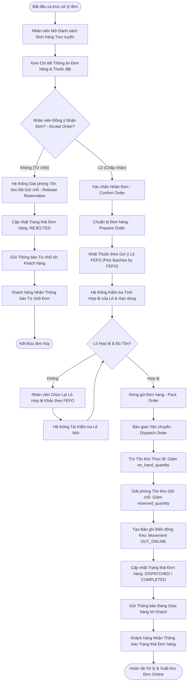

# ĐẶC TẢ LUỒNG HOẠT ĐỘNG SWL 2.2: XỬ LÝ ĐƠN HÀNG TRỰC TUYẾN, XUẤT KHO FEFO & GIAO HÀNG
## (PROCESS & DISPATCH ONLINE ORDERS WORKFLOW)

> **Dự án:** PharmaFlow — Hệ thống Quản lý Kho & Bán hàng Thông minh cho Nhà thuốc Tư nhân  
> **Mã luồng:** `SWL-2.2` | **Mã tiến trình Draw.io:** `Swl 2.2` (Process Online Orders)  
> **Phân hệ:** Vận hành Nhà thuốc (Pharmacy Staff Console & Fulfillment)  
> **Mã tài liệu:** `02_Requirement/7mainflow/Description SWL 2.md`  
> **Phiên bản:** v1.0 | **Ngày ban hành:** 13/10/2026  

---

## 1. TỔNG QUAN NGHIỆP VỤ (BUSINESS OVERVIEW)

### 1.1. Mục tiêu & Ý nghĩa
Luồng **SWL 2.2** mô tả quy trình nghiệp vụ của Dược sĩ / Nhân viên nhà thuốc (Pharmacy Staff) trong việc tiếp nhận các đơn hàng trực tuyến được tạo từ **SWL 2.1**. Quy trình bao gồm: thẩm định thông tin đơn hàng, duyệt hoặc từ chối đơn, tự động phân bổ lô thuốc theo nguyên tắc **Hạn sử dụng sớm nhất - Xuất trước (FEFO)**, đóng gói, bàn giao đơn vị vận chuyển (Dispatch), chính thức trừ tồn kho thực tế, giải phóng giữ chỗ (Release Reservation), ghi nhận biến động kho và thông báo trạng thái cho khách hàng.

### 1.2. Phạm vi & Tác nhân tham gia
- **Nhân viên / Dược sĩ (Pharmacy Staff):** Mở danh sách đơn trực tuyến, rà soát thuốc, chấp nhận/từ chối đơn, nhặt hàng theo lô FEFO gợi ý, đóng gói và xác nhận gửi hàng.
- **Hệ thống PharmaFlow (System):** Đề xuất lô FEFO có hạn dùng gần nhất còn hợp lệ, kiểm tra tính hợp lệ của lô (không bị khóa, còn hạn), trừ tồn kho `on_hand_quantity`, giảm `reserved_quantity`, tạo bản ghi lịch sử di chuyển kho (`inventory_movements`), gửi thông báo cho khách.
- **Khách hàng (Customer):** Nhận thông báo xác nhận đơn hàng, thông báo từ chối (nếu hủy), hoặc thông báo đơn hàng đang được giao.

### 1.3. Căn cứ pháp lý & Quy tắc nghiệp vụ (Business Rules)
- **BR11 (Nguyên tắc FEFO):** Bắt buộc chọn xuất các lô thuốc có hạn sử dụng gần nhất trước, loại bỏ nguy cơ tồn đọng thuốc hết hạn trong kho.
- **BR16 (Cấm tồn kho âm):** Kiểm tra tồn kho vật lý tại thời điểm xuất trước khi trừ kho thực tế.
- **BR18 (Cấm bán thuốc quá hạn):** Hệ thống kiên quyết từ chối chọn các lô có `expiry_date <= ngày hiện tại` hoặc lô đang bị khóa (`BLOCKED`).
- **BR23 (Quản lý theo Đơn vị cơ sở):** Quy đổi số lượng đóng gói của đơn hàng về đơn vị nhỏ nhất khi trừ lô kho.

---

## 2. SƠ ĐỒ TIẾN TRÌNH HOẠT ĐỘNG (WORKFLOW DIAGRAM)

*Sơ đồ ánh xạ trực tiếp từ trang `Swl 2.2` trong tệp thiết kế `pharma.drawio`:*



---

## 3. BẢNG KỊCH BẢN THỰC THI TỪNG BƯỚC (STEP-BY-STEP SCENARIO TABLE)

| Bước | Tác nhân | Hành động & Thao tác Giao diện | Xử lý Hệ thống & Logic Backend | Ràng buộc (BR) | Kết quả đầu ra |
|:---:|:---|:---|:---|:---:|:---|
| **1** | Nhân viên | Truy cập màn hình `staff/online-order-list.jsp` | `OnlineFulfillmentServlet` (GET): Truy vấn các đơn hàng có trạng thái `PENDING` hoặc `PROCESSING` | — | Hiển thị danh sách đơn chờ xử lý, sắp xếp theo thời gian đặt |
| **2** | Nhân viên | Nhấn vào một đơn hàng để xem chi tiết (`staff/online-order-detail.jsp`) | Nạp thông tin khách hàng, địa chỉ, danh sách thuốc, cờ Rx, số lượng đặt | BR07 | Màn hình chi tiết đơn hiển thị đầy đủ thông tin đối chiếu |
| **3** | Nhân viên | Thẩm định đơn hàng: kiểm tra đơn thuốc (nếu có thuốc Rx) và quyết định nhận đơn | Nếu từ chối: Nhập lý do từ chối $\rightarrow$ bấm nút **"Từ chối đơn"** (Reject) | BR13 | Kích hoạt nhánh hủy đơn |
| **4a** | Hệ thống | Xử lý khi từ chối đơn hàng (Reject branch) | Giảm `reserved_quantity` trên các SKU tương ứng; cập nhật `status = 'CANCELLED'`; gửi email/SMS cho khách | BR16 | Tồn kho giữ chỗ được giải phóng; khách nhận được lý do từ chối |
| **4b** | Nhân viên | Nếu đồng ý nhận đơn: Bấm nút **"Xác nhận nhận đơn"** (Confirm Order) | `OnlineFulfillmentServlet` (POST `action=confirm`): Cập nhật đơn hàng sang trạng thái `CONFIRMED` | — | Đơn chuyển sang trạng thái sẵn sàng nhặt hàng |
| **5** | Nhân viên | Bấm nút **"Chuẩn bị hàng / Nhặt hàng"** | Hệ thống chạy thuật toán FEFO: truy vấn bảng `inventory_batches` có `expiry_date` gần nhất, trạng thái `ACTIVE` | BR11, BR18 | Hiển thị danh sách gợi ý: Tên thuốc, Vị trí kệ, Số lô cần lấy, HSD |
| **6** | Nhân viên | Đi đến kệ thuốc, lấy đúng số lô được chỉ định và quét barcode kiểm tra | So khớp mã lô thực tế với mã lô hệ thống đề xuất | BR10, BR11 | Đảm bảo lấy đúng lô thuốc chuẩn bị xuất |
| **7** | Hệ thống | Kiểm định tính hợp lệ của lô thuốc đã chọn (Validate batches) | Kiểm tra: Lô không bị khóa (`status != 'BLOCKED'`), HSD còn $> 0$ ngày, số lượng thực tế đủ để xuất | BR16, BR18 | Nếu không hợp lệ $\rightarrow$ báo lỗi, yêu cầu Dược sĩ đổi lô khác |
| **8** | Nhân viên | Đóng gói đơn hàng, dán phiếu giao hàng có in mã vận đơn | Cập nhật trạng thái đóng gói hoàn tất | — | Kiện hàng sẵn sàng bàn giao |
| **9** | Nhân viên | Bàn giao cho shipper và bấm nút **"Xuất kho & Giao hàng"** (Dispatch) | `OnlineFulfillmentServlet` (POST `action=dispatch`): Bắt đầu Transaction xuất kho | BR11, BR16 | Bắt đầu cập nhật dữ liệu kho |
| **10** | Hệ thống | Trừ tồn kho thực tế và giải phóng giữ chỗ trong Transaction | - Trừ `on_hand_quantity` của từng `inventory_batch`<br/>- Giảm `reserved_quantity` của SKU tương ứng | BR16, BR23 | Tồn kho thực tế được cập nhật chính xác tuyệt đối |
| **11** | Hệ thống | Tạo bản ghi biến động kho (`inventory_movements`) | Insert `inventory_movements`: `movement_type = 'SALE_ONLINE'`, `quantity`, `batch_id`, `reference_id = order_id` | Audit Trail | Lưu vết toàn bộ lịch sử xuất kho phục vụ thanh tra GPP |
| **12** | Hệ thống | Cập nhật trạng thái đơn hàng sang `SHIPPING` / `DISPATCHED` | Cập nhật bảng `orders`: `status = 'SHIPPING'`, ghi thời gian xuất kho | — | Đơn hàng chuyển sang bộ phận vận chuyển theo dõi |
| **13** | Hệ thống | Gửi thông báo tự động tới khách hàng | Đẩy thông báo/email: "Đơn hàng của bạn đang được giao" kèm mã tra cứu vận đơn | — | Khách hàng nhận thông báo thời gian thực |

---

## 4. ÁNH XẠ GIAO DIỆN & LUỒNG MÀN HÌNH (UI/UX SCREEN FLOW)

### 4.1. Màn hình liên quan
- **`SCR_STAFF_ORDER_LIST` (`staff/online-order-list.jsp`):** Bộ lọc trạng thái đơn hàng (`Tất cả`, `Chờ duyệt`, `Đang chuẩn bị`, `Đang giao`).
- **`SCR_STAFF_ORDER_DETAIL` (`staff/online-order-detail.jsp`):** Chi tiết đơn, bảng danh sách mặt hàng, bảng phân bổ số lô FEFO, nút "Xác nhận", nút "Hủy đơn", nút "Xuất kho giao hàng".
- **`MODAL_REJECT_ORDER`:** Popup nhập lý do từ chối đơn hàng (ví dụ: Không liên lạc được khách, đơn thuốc không hợp lệ, v.v.).

### 4.2. Các phần tử tương tác quan trọng
- **Bảng phân bổ lô FEFO:** Hiển thị rõ ràng Số lô (`Batch No`), Hạn dùng (`Exp Date`), Số lượng cần lấy từ lô đó.
- **Nút "Xuất kho & Giao hàng":** Chỉ sáng lên khi tất cả các dòng sản phẩm đã được chọn đủ số lô hợp lệ.

---

## 5. ĐẶC TẢ KỸ THUẬT & SOURCE CODE MAPPING

### 5.1. Controller & Backend Handling
- **Controller chính:** `src/java/controller/OnlineFulfillmentServlet.java`.
- **Phương thức xử lý cốt lõi:**
  - `doGet()`: Lấy danh sách đơn hàng `OrderDAO.getOrdersByStatus("PENDING")`.
  - `handleConfirmOrder()`: Cập nhật `OrderDAO.updateStatus(orderId, "CONFIRMED")`.
  - `handleDispatchOrder()`:
    ```java
    Connection conn = DBContext.getConnection();
    try {
        conn.setAutoCommit(false);
        for (OrderItem item : orderItems) {
            List<BatchAllocation> batches = inventoryDAO.allocateBatchesFEFO(item.getProductId(), item.getQuantity());
            for (BatchAllocation b : batches) {
                inventoryBatchDAO.deductBatchQuantity(conn, b.getBatchId(), b.getAllocatedQty());
                inventoryMovementDAO.logMovement(conn, b.getBatchId(), "SALE_ONLINE", b.getAllocatedQty(), orderId);
            }
            productDAO.decreaseReservedStock(conn, item.getProductId(), item.getQuantity());
        }
        orderDAO.updateStatus(conn, orderId, "SHIPPING");
        conn.commit();
    } catch (Exception e) {
        conn.rollback();
    }
    ```

### 5.2. Bảng cơ sở dữ liệu tác động
- `orders`: `status` (`CONFIRMED`, `SHIPPING`, `CANCELLED`).
- `inventory_batches`: Trừ `on_hand_quantity`.
- `products`: Trừ `reserved_stock`.
- `inventory_movements`: Ghi mới bản ghi xuất kho.

---

## 6. LUỒNG NGOẠI LỆ & RỦI RO (ALTERNATIVE & EXCEPTION FLOWS)

| Mã ngoại lệ | Tình huống phát sinh | Cách xử lý hệ thống |
|:---:|:---|:---|
| **EX-2.2.1** | Lô thuốc FEFO được hệ thống gợi ý nhưng thực tế tại quầy bị hỏng/vỡ bao bì | Nhân viên chọn nút "Đổi lô khác", nhập lý do "Bao bì rách hỏng"; hệ thống gợi ý lô tiếp theo có HSD gần thứ hai. Đồng thời gắn cờ lô hỏng để đưa sang **SWL 2.5/2.6** kiểm tra. |
| **EX-2.2.2** | Đơn hàng có thuốc kê đơn nhưng khách không tải đơn thuốc hoặc đơn thuốc giả mạo | Dược sĩ gọi điện cho khách yêu cầu bổ sung; nếu khách từ chối $\rightarrow$ Dược sĩ từ chối đơn hàng với lý do "Vi phạm quy chế bán thuốc kê đơn BR13". |
| **EX-2.2.3** | Quá trình trừ tồn kho bị xung đột dữ liệu (Deadlock hoặc Race condition) | Cơ chế Transaction tự động rollback, hiển thị thông báo "Dữ liệu kho đang cập nhật, vui lòng thử lại thao tác trong giây lát". |

---

## 7. TIÊU CHÍ NGHIỆM THU (ACCEPTANCE CRITERIA)
- [x] Nhân viên xem được chi tiết đơn hàng trực tuyến và các thông tin liên hệ.
- [x] Hệ thống tự động gợi ý chính xác lô thuốc theo thuật toán FEFO (HSD sớm nhất xếp trước).
- [x] Khi bấm Dispatch, tồn kho thực tế bị trừ đúng số lô đó, tồn kho giữ chỗ được xóa bỏ và lịch sử biến động kho được ghi đầy đủ.
- [x] Khách hàng nhận được cập nhật trạng thái đơn hàng thời gian thực.
