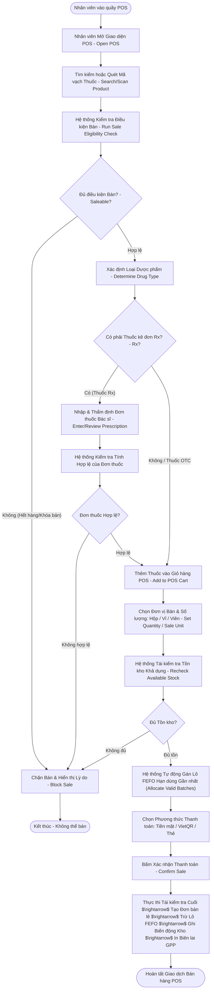

# ĐẶC TẢ LUỒNG HOẠT ĐỘNG SWL 2.3: BÁN HÀNG TẠI QUẦY POS & KIỂM SOÁT ĐƠN THUỐC RX
## (POS SALES & PRESCRIPTION VERIFICATION WORKFLOW — BF-03)

> **Dự án:** PharmaFlow — Hệ thống Quản lý Kho & Bán hàng Thông minh cho Nhà thuốc Tư nhân  
> **Mã luồng:** `SWL-2.3` | **Mã tiến trình Draw.io:** `2.3` (`BF-03 POS Sales`)  
> **Phân hệ:** Quầy Bán Lẻ POS & An toàn Dược học (Point-of-Sale Terminal)  
> **Mã tài liệu:** `02_Requirement/7mainflow/Description SWL 3.md`  
> **Phiên bản:** v1.0 | **Ngày ban hành:** 13/10/2026  

---

## 1. TỔNG QUAN NGHIỆP VỤ (BUSINESS OVERVIEW)

### 1.1. Mục tiêu & Ý nghĩa
Luồng **SWL 2.3 (BF-03)** là luồng vận hành cốt lõi trực tiếp tạo ra doanh thu tại quầy thuốc vật lý. Quy trình đảm bảo:
- Quét mã vạch và tìm kiếm thuốc siêu tốc trong $< 200\text{ms}$.
- Kiểm tra tính hợp lệ và điều kiện bán của sản phẩm trong kho.
- Thực thi nghiêm ngặt quy định của Bộ Y tế về **Thuốc kê đơn (Rx)**: bắt buộc thẩm định và lưu thông tin đơn thuốc của bác sĩ trước khi cho phép thanh toán.
- Cho phép bán lẻ linh hoạt theo nhiều quy cách đóng gói (Hộp/Vỉ/Viên) thông qua cơ chế quy đổi đơn vị cơ sở.
- Tự động trừ kho theo nguyên tắc FEFO (First-Expired, First-Out), khóa sửa giá đối với nhân viên thu ngân và in hóa đơn chuẩn GPP chứa đầy đủ Số lô & Hạn sử dụng.

### 1.2. Phạm vi & Tác nhân tham gia
- **Nhân viên bán hàng / Dược sĩ (Pharmacy Staff):** Thao tác trên giao diện POS, dùng máy quét barcode, thẩm định đơn thuốc Rx, chọn đơn vị bán, chọn phương thức thanh toán và xác nhận giao dịch.
- **Hệ thống PharmaFlow (System):** Chạy kiểm tra điều kiện bán (Sale eligibility), phân loại thuốc Rx/OTC, kiểm tra tồn kho khả dụng, phân bổ lô FEFO tự động, tính thuế/chiết khấu, khóa trường sửa giá của nhân viên, trừ tồn kho và in hóa đơn.

### 1.3. Căn cứ pháp lý & Quy tắc nghiệp vụ (Business Rules)
- **BR11 (Xuất kho FEFO):** Tự động phân bổ và trừ tồn ở lô có hạn dùng gần nhất trước.
- **BR12 (Khóa sửa giá):** Nhân viên thu ngân (`Staff`) không được phép tự ý thay đổi đơn giá bán lẻ đã niêm yết tại màn hình POS.
- **BR13 & BR24 (Bắt buộc đơn thuốc khi bán thuốc Rx):** Nếu giỏ hàng có thuốc kê đơn, hệ thống khóa nút thanh toán cho đến khi thông tin bác sĩ, cơ sở y tế và ảnh đơn thuốc được ghi nhận hợp lệ.
- **BR14 (Phương thức thanh toán):** Bắt buộc chọn phương thức thanh toán (Tiền mặt, VietQR, Thẻ).
- **BR15 (Thông tin lô trên biên lai GPP):** Hóa đơn bán lẻ in ra bắt buộc phải có Tên thuốc, Hoạt chất, Số lô (`Batch No`), Hạn dùng (`Exp Date`), Số GPP nhà thuốc.
- **BR16 (Cấm tồn kho âm):** Kiểm tra tồn kho trước và trong quá trình commit giao dịch bán.
- **BR23 (Quản lý theo Base Unit):** Mọi đơn vị bán lẻ (Hộp, Vỉ) đều được quy đổi ra Viên để kiểm tra và trừ kho.

---

## 2. SƠ ĐỒ TIẾN TRÌNH HOẠT ĐỘNG (WORKFLOW DIAGRAM)

*Sơ đồ ánh xạ trực tiếp từ trang `2.3` trong tệp thiết kế `pharma.drawio`:*



---

## 3. BẢNG KỊCH BẢN THỰC THI TỪNG BƯỚC (STEP-BY-STEP SCENARIO TABLE)

| Bước | Tác nhân | Hành động & Thao tác Giao diện | Xử lý Hệ thống & Logic Backend | Ràng buộc (BR) | Kết quả đầu ra |
|:---:|:---|:---|:---|:---:|:---|
| **1** | Nhân viên | Mở màn hình bán hàng POS (`pos/dashboard.jsp`) | `PosServlet` (GET): Nạp phiên ca làm việc hiện tại, bảng giá sản phẩm, các danh mục thuốc thường dùng | BR27 | Màn hình POS sẵn sàng quét mã |
| **2** | Nhân viên | Cầm máy quét mã vạch quét mã trên hộp thuốc hoặc gõ tìm kiếm theo Tên / Hoạt chất | `PosServlet` (AJAX tra cứu): Tìm chỉ mục `barcode` hoặc `name` trong $< 200\text{ms}$ | BR16, BR18 | Hiển thị thông tin thuốc, dạng bào chế, các đơn vị bán có sẵn |
| **3** | Hệ thống | Kiểm tra tính khả dụng (Sale eligibility check) | Kiểm tra cờ `status = 'HOAT_DONG'`, còn ít nhất 1 lô chưa hết hạn và không bị khóa | BR16, BR18 | Nếu không đạt $\rightarrow$ chặn thêm vào giỏ, báo "Thuốc tạm khóa bán hoặc hết hàng" |
| **4** | Hệ thống | Phân tích thuộc tính dược phẩm: Kiểm tra cờ `rx_flag` | Nếu `rx_flag = TRUE`, kích hoạt quy trình kiểm soát đơn thuốc; nếu `FALSE` (OTC) $\rightarrow$ cho phép vào giỏ ngay | BR07 | Điều hướng luồng nghiệp vụ tương ứng |
| **5** | Nhân viên | (Nếu là thuốc Rx) Mở popup **"Thông tin Đơn thuốc"** | Nhân viên nhập: Tên Bác sĩ kê đơn, Bệnh viện/Phòng khám, Ngày kê đơn, chụp/tải ảnh đơn thuốc | BR13, BR24 | Lưu tạm thông tin đơn thuốc gắn với dòng sản phẩm |
| **6** | Hệ thống | Thẩm định tính đầy đủ của đơn thuốc | Bắt buộc có đủ: Tên bác sĩ, Cơ sở khám chữa bệnh, Ảnh đơn thuốc hợp lệ | BR13, BR24 | Nếu thiếu bất kỳ trường nào $\rightarrow$ chặn thêm vào giỏ |
| **7** | Nhân viên | Thêm sản phẩm vào giỏ hàng POS, chọn Đơn vị bán (Hộp/Vỉ/Viên) và nhập số lượng | Hệ thống nhân với hệ số quy đổi để ra số viên cơ sở (`requested_base_qty`). Kiểm tra trường giá bị khóa | BR12, BR23 | Thu ngân không thể sửa đơn giá niêm yết; giỏ hàng cập nhật tiền |
| **8** | Hệ thống | Tái kiểm tra tồn kho & Tự động phân bổ lô theo FEFO | Truy vấn `inventory_batches` theo `ORDER BY expiry_date ASC`. Lấy từ lô hạn gần nhất đến khi đủ số lượng | BR11, BR16 | Xác định danh sách các lô sẽ xuất cho dòng hàng này |
| **9** | Nhân viên | Khách hàng chọn hình thức thanh toán $\rightarrow$ Thu ngân nhấn chọn phương thức tương ứng | - Tiền mặt: nhập tiền khách đưa $\rightarrow$ tự động tính tiền thừa<br/>- VietQR: hiển thị mã QR động chứa đúng số tiền | BR14 | Sẵn sàng xác nhận thanh toán |
| **10** | Nhân viên | Nhấn nút **"Thanh toán & In hóa đơn"** (Confirm Sale) | `PosServlet` (POST): Mở Transaction kết nối cơ sở dữ liệu `connection.setAutoCommit(false)` | — | Bắt đầu chuỗi xử lý nguyên tử (Atomic Transaction) |
| **11** | Hệ thống | Tái kiểm tra lần cuối (Final Revalidation) | Khóa dòng dữ liệu `SELECT ... FOR UPDATE` để chống bán đè (Race Condition) | BR16 | Đảm bảo tính toàn vẹn dữ liệu kho |
| **12** | Hệ thống | Tạo đơn bán lẻ, trừ kho lô FEFO & lưu biến động kho | - Insert bảng `sales`, `sale_items`<br/>- Update giảm `on_hand_quantity` các lô FEFO đã chọn<br/>- Insert `inventory_movements` (`movement_type = 'SALE_POS'`) | BR11, BR15 | Dữ liệu giao dịch được ghi nhận vĩnh viễn |
| **13** | Hệ thống | Commit transaction & Tạo lệnh in Hóa đơn GPP | Gửi lệnh in hóa đơn qua máy in nhiệt: thể hiện rõ Tên thuốc, Hoạt chất, Số lô, Hạn dùng, Hướng dẫn sử dụng | BR15, GPP | In hóa đơn bàn giao cho khách hàng; màn hình POS reset về giỏ mới |

---

## 4. ÁNH XẠ GIAO DIỆN & LUỒNG MÀN HÌNH (UI/UX SCREEN FLOW)

### 4.1. Màn hình liên quan
- **`SCR_POS_MAIN` (`pos/dashboard.jsp`):** Giao diện bán hàng chính gồm 3 cột: Cột 1 (Tìm kiếm & Danh mục nhanh), Cột 2 (Giỏ hàng POS hiện tại & Bộ chọn đơn vị), Cột 3 (Bảng tính tiền, phương thức thanh toán, nút xác nhận).
- **`MODAL_PRESCRIPTION_INPUT`:** Hộp thoại chụp ảnh hoặc nhập thông tin đơn thuốc bác sĩ cho sản phẩm Rx.
- **`MODAL_PAYMENT_QR`:** Popup hiển thị mã VietQR động để khách quét thanh toán nhanh.
- **`SCR_POS_RECEIPT` (`pos/pos-detail.jsp`):** Chi tiết hóa đơn và bản xem trước trước khi in nhiệt 80mm.

### 4.2. Các phần tử tương tác quan trọng
- **Ô quét mã vạch:** Luôn nhận focus tự động (`autofocus`), hỗ trợ phím tắt `F2` để tìm kiếm, `F9` để thanh toán nhanh.
- **Badge phân loại thuốc:** Thuốc kê đơn có nhãn `[Rx]` màu đỏ; thuốc không kê đơn có nhãn `[OTC]` màu xanh lam.
- **Trường Đơn vị tính:** Dropdown cho phép đổi tức thì giữa Hộp, Vỉ, Viên; tổng tiền cập nhật thời gian thực.

---

## 5. ĐẶC TẢ KỸ THUẬT & SOURCE CODE MAPPING

### 5.1. Controller & Backend Handling
- **Controller chính:** `src/java/controller/PosServlet.java`.
- **Luồng xử lý POST bán hàng (`handleCheckout`):**
  ```java
  Connection conn = DBContext.getConnection();
  try {
      conn.setAutoCommit(false);
      // 1. Kiểm tra quyền nhân viên và trạng thái ca thu ngân
      checkActiveShift(conn, staffId);
      
      // 2. Validate đơn thuốc đối với các dòng hàng Rx
      validatePrescriptionDetails(cartItems);
      
      // 3. Tạo bản ghi hóa đơn bán lẻ
      int saleId = saleDAO.createSale(conn, staffId, totalAmount, paymentMethod);
      
      // 4. Trừ kho theo thuật toán FEFO
      for (CartItem item : cartItems) {
          int remainingQty = item.getBaseQuantity();
          List<InventoryBatch> batches = batchDAO.getActiveBatchesFEFO(conn, item.getProductId());
          for (InventoryBatch batch : batches) {
              if (remainingQty <= 0) break;
              int deductQty = Math.min(batch.getOnHandQuantity(), remainingQty);
              batchDAO.deductQuantity(conn, batch.getId(), deductQty);
              movementDAO.recordMovement(conn, batch.getId(), "SALE_POS", deductQty, saleId);
              saleItemDAO.createSaleItem(conn, saleId, item.getProductId(), batch.getId(), deductQty, item.getPrice());
              remainingQty -= deductQty;
          }
          if (remainingQty > 0) throw new InsufficientStockException("Không đủ tồn kho khả dụng");
      }
      conn.commit();
  } catch (Exception e) {
      conn.rollback();
  }
  ```

### 5.2. Bảng cơ sở dữ liệu tác động
- `sales`: `id`, `staff_id`, `shift_id`, `total_amount`, `discount_amount`, `payment_method`, `created_at`.
- `sale_items`: `id`, `sale_id`, `product_id`, `batch_id`, `quantity`, `unit_price`, `sale_unit`.
- `prescriptions`: `id`, `sale_id`, `doctor_name`, `hospital_name`, `image_url`.
- `inventory_batches`: Trừ `on_hand_quantity`.
- `inventory_movements`: Ghi nhật ký xuất bán POS.

---

## 6. LUỒNG NGOẠI LỆ & RỦI RO (ALTERNATIVE & EXCEPTION FLOWS)

| Mã ngoại lệ | Tình huống phát sinh | Cách xử lý hệ thống |
|:---:|:---|:---|
| **EX-2.3.1** | Khách mua thuốc kê đơn nhưng không có đơn thuốc của bác sĩ | Nhân viên giải thích quy định pháp luật (Luật Dược 105/2016). Hệ thống kiên quyết không mở nút thanh toán; nhân viên chỉ có thể hủy dòng hàng đó khỏi giỏ. |
| **EX-2.3.2** | Số lượng khách muốn mua vượt quá tồn kho khả dụng của tất cả các lô gộp lại | Hệ thống hiển thị cảnh báo: *"Số lượng tối đa có thể bán hiện tại là [Số lượng]".* Tự động điều chỉnh số lượng giỏ hàng về mức tối đa có thể bán. |
| **EX-2.3.3** | Khách quét mã VietQR nhưng tài khoản ngân hàng chưa trừ tiền hoặc chậm phản hồi | Thu ngân có nút "Kiểm tra trạng thái giao dịch". Nếu quá 3 phút không nhận được IPN từ ngân hàng, hỗ trợ chuyển sang hình thức tiền mặt. |

---

## 7. TIÊU CHÍ NGHIỆM THU (ACCEPTANCE CRITERIA)
- [x] Quét barcode hiển thị đúng sản phẩm và đơn vị quy đổi tương ứng trong $< 200\text{ms}$.
- [x] Nhân viên thu ngân không thể sửa đơn giá niêm yết trên giao diện POS.
- [x] Thuốc có cờ `Rx_Flag = TRUE` bắt buộc phải có thông tin đơn thuốc mới cho phép bấm thanh toán.
- [x] Lô thuốc được trừ tồn kho hoàn toàn tự động theo đúng nguyên tắc FEFO (hạn dùng gần nhất xuất trước).
- [x] Hóa đơn in ra hiển thị rõ ràng Số lô và Hạn dùng của từng mặt hàng theo chuẩn GPP.
