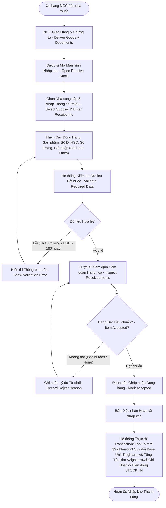

# ĐẶC TẢ LUỒNG HOẠT ĐỘNG SWL 2.4: TIẾP NHẬN HÀNG & NHẬP KHO THEO LÔ
## (STOCK RECEIVING & BATCH INWARDING WORKFLOW — BF-04)

> **Dự án:** PharmaFlow — Hệ thống Quản lý Kho & Bán hàng Thông minh cho Nhà thuốc Tư nhân  
> **Mã luồng:** `SWL-2.4` | **Mã tiến trình Draw.io:** `2.4` (`BF-04 Stock Receiving`)  
> **Phân hệ:** Quản lý Kho Dược & Chuỗi Cung ứng (Inventory & Procurement)  
> **Mã tài liệu:** `02_Requirement/7mainflow/Description SWL 4.md`  
> **Phiên bản:** v1.0 | **Ngày ban hành:** 13/10/2026  

---

## 1. TỔNG QUAN NGHIỆP VỤ (BUSINESS OVERVIEW)

### 1.1. Mục tiêu & Ý nghĩa
Luồng **SWL 2.4 (BF-04)** kiểm soát chặt chẽ toàn bộ quá trình nhập thuốc từ Nhà cung cấp vào kho của nhà thuốc. Đây là "cửa ngõ" quan trọng nhất để đảm bảo chất lượng thuốc và nguồn gốc xuất xứ theo chuẩn GPP:
- Tiếp nhận hàng hóa vật lý và hóa đơn/chứng từ giao hàng từ Nhà cung cấp.
- Khai báo và thẩm định các thông tin bắt buộc: **Số lô sản xuất (Batch No)**, **Ngày sản xuất**, **Hạn sử dụng (Expiry Date)**, **Số lượng**, **Đơn giá nhập (Cost Price)**.
- Kiểm tra ngoại quan vật lý của thuốc (bao bì không rách, tem niêm phong nguyên vẹn).
- Thực thi quy tắc GPP: từ chối nhập các lô thuốc có hạn sử dụng còn lại dưới 180 ngày (6 tháng).
- Tự động quy đổi số lượng về đơn vị cơ sở nhỏ nhất (Viên/Gói) và ghi nhận biến động kho `STOCK_IN`.

### 1.2. Phạm vi & Tác nhân tham gia
- **Nhà cung cấp (Supplier):** Giao hàng thực tế, bàn giao hóa đơn GTGT và phiếu giao hàng.
- **Nhân viên / Dược sĩ / Chủ nhà thuốc (Authorized Staff / Owner-Admin):** Mở form nhập kho, chọn NCC, nhập từng dòng hàng, kiểm định cảm quan, xác nhận chấp nhận hoặc từ chối từng mặt hàng.
- **Hệ thống PharmaFlow (System):** Validate dữ liệu đầu vào, kiểm tra điều kiện HSD $\ge 180$ ngày, quy đổi đơn vị tính cơ sở, tạo bản ghi lô mới trong `inventory_batches`, cập nhật tồn kho tổng và lưu vết lịch sử biến động.

### 1.3. Căn cứ pháp lý & Quy tắc nghiệp vụ (Business Rules)
- **BR10 (Số lô & Hạn dùng bắt buộc khi nhập kho):** Bắt buộc phải có Số lô và HSD. Hạn dùng tính từ ngày nhập phải $\ge 180$ ngày; nếu không hệ thống sẽ từ chối nhập kho để tránh nhập hàng cận date.
- **BR16 (Cấm số lượng âm):** Số lượng nhập và giá vốn nhập bắt buộc phải $> 0$.
- **BR23 (Quản lý theo Base Unit):** Số lượng nhập theo Thùng/Hộp được tự động nhân hệ số quy đổi về đơn vị nhỏ nhất để lưu vào cơ sở dữ liệu.
- **BR09 (Hồ sơ Nhà cung cấp):** Nhà cung cấp phải có đầy đủ thông tin pháp lý (Mã số thuế, Địa chỉ, Email) trước khi tạo phiếu nhập.

---

## 2. SƠ ĐỒ TIẾN TRÌNH HOẠT ĐỘNG (WORKFLOW DIAGRAM)

*Sơ đồ ánh xạ trực tiếp từ trang `2.4` trong tệp thiết kế `pharma.drawio`:*



---

## 3. BẢNG KỊCH BẢN THỰC THI TỪNG BƯỚC (STEP-BY-STEP SCENARIO TABLE)

| Bước | Tác nhân | Hành động & Thao tác Giao diện | Xử lý Hệ thống & Logic Backend | Ràng buộc (BR) | Kết quả đầu ra |
|:---:|:---|:---|:---|:---:|:---|
| **1** | Nhà cung cấp | Bàn giao thùng hàng thuốc, phiếu xuất kho và hóa đơn tại quầy kho | Dược sĩ tiếp nhận hồ sơ giấy tờ | — | Bắt đầu quy trình kiểm nhận |
| **2** | Dược sĩ | Mở màn hình Lập phiếu nhập kho (`admin/goods-receipt-form.jsp`) | `GoodsReceiptServlet` (GET): Nạp danh sách Nhà cung cấp hoạt động, danh mục thuốc | BR09 | Form nhập kho sẵn sàng nhập liệu |
| **3** | Dược sĩ | Chọn Nhà cung cấp, nhập Số hóa đơn NCC, Ngày hóa đơn, Ghi chú | Kiểm tra NCC có tồn tại và đang hoạt động (`status = 'ACTIVE'`) | BR09 | Header của phiếu nhập kho được tạo |
| **4** | Dược sĩ | Nhấn **"Thêm dòng thuốc"**, chọn Sản phẩm, nhập: Số lô (`Batch No`), Hạn dùng (`Exp Date`), Số lượng, Đơn vị nhập (Hộp/Thùng), Giá nhập | Hệ thống kiểm tra dữ liệu bắt buộc: Sản phẩm, Số lô không rỗng, Giá nhập $> 0$ | BR10, BR16 | Dòng hàng được đưa vào danh sách kiểm nhận |
| **5** | Hệ thống | Kiểm tra tính hợp lệ của Hạn sử dụng: `expiry_date - current_date >= 180 ngày` | Tính toán số ngày còn lại của hạn dùng. Nếu $< 180$ ngày $\rightarrow$ chặn và báo lỗi cận date | BR10 | Đảm bảo không nhập thuốc cận hạn |
| **6** | Dược sĩ | Tiến hành kiểm tra ngoại quan thực tế từng hộp thuốc: tem niêm phong, vỉ không dập nát, nhãn mác rõ ràng | Thao tác vật lý đối chiếu với chứng từ | GPP | Đánh giá chất lượng thực tế |
| **7** | Dược sĩ | Nếu hàng bị móp méo/hỏng $\rightarrow$ nhấn **"Từ chối dòng này"**, chọn lý do (Hỏng vỏ, sai quy cách) | Hệ thống loại bỏ dòng hàng khỏi danh sách nhập; ghi nhận lý do vào biên bản từ chối | — | Lô hỏng không bị nhập vào kho |
| **8** | Dược sĩ | Nếu hàng đạt chuẩn $\rightarrow$ đánh dấu **"Đạt tiêu chuẩn"** cho từng dòng | Hệ thống tính toán tổng tiền phiếu nhập: $\sum (\text{Quantity}_i \times \text{CostPrice}_i)$ | — | Tổng giá trị phiếu nhập được cập nhật |
| **9** | Dược sĩ | Nhấn nút **"Xác nhận Nhập kho"** (Confirm Stock Receipt) | `GoodsReceiptServlet` (POST): Bắt đầu mở Transaction cơ sở dữ liệu `connection.setAutoCommit(false)` | — | Bắt đầu xử lý lưu kho nguyên tử |
| **10** | Hệ thống | Quy đổi số lượng về đơn vị cơ sở nhỏ nhất (Base Unit) | Nhân số lượng nhập với hệ số quy đổi: `base_qty = qty * conversion_factor` | BR23 | Tránh sai số làm tròn khi bán lẻ |
| **11** | Hệ thống | Tạo bản ghi lô thuốc mới trong bảng `inventory_batches` | Insert: `batch_number`, `product_id`, `expiry_date`, `on_hand_quantity = base_qty`, `cost_price`, `status = 'ACTIVE'` | BR10, BR11 | Lô mới sẵn sàng cho thuật toán FEFO |
| **12** | Hệ thống | Ghi bản ghi phiếu nhập (`goods_receipts`) và chi tiết (`goods_receipt_items`) | Insert dữ liệu phiếu nhập, liên kết với ID nhà cung cấp và mã người lập phiếu | Audit Trail | Lưu vết kiểm toán tài chính |
| **13** | Hệ thống | Ghi nhật ký biến động kho (`inventory_movements`) | Insert: `movement_type = 'STOCK_IN'`, `quantity = base_qty`, `batch_id`, `reference_id = receipt_id` | Audit Trail | Hoàn tất lịch sử truy vết GPP |
| **14** | Hệ thống | Commit transaction & Chuyển hướng sang màn hình Chi tiết phiếu nhập | Hiển thị mã phiếu nhập vừa tạo (`goods-receipt-detail.jsp`), cho phép in phiếu nhập kho | — | Thuốc mới chính thức có sẵn trong kho để bán |

---

## 4. ÁNH XẠ GIAO DIỆN & LUỒNG MÀN HÌNH (UI/UX SCREEN FLOW)

### 4.1. Màn hình liên quan
- **`SCR_ADM_GOODS_RECEIPT_LIST` (`admin/goods-receipt-list.jsp`):** Danh sách các phiếu nhập kho đã thực hiện, lọc theo ngày và nhà cung cấp.
- **`SCR_ADM_GOODS_RECEIPT_FORM` (`admin/goods-receipt-form.jsp`):** Giao diện lập phiếu nhập nhiều dòng (Dynamic multi-row item table).
- **`SCR_ADM_GOODS_RECEIPT_DETAIL` (`admin/goods-receipt-detail.jsp`):** Xem lại toàn bộ thông tin phiếu nhập, danh sách lô và giá trị tiền hàng.

### 4.2. Các phần tử tương tác quan trọng
- **Bảng nhập liệu động (Dynamic Row):** Nút "+ Thêm sản phẩm" cho phép thêm nhiều dòng thuốc trong cùng một phiếu nhập.
- **Bộ kiểm tra HSD tự động bằng màu sắc:**
  - HSD $> 1$ năm: Viền xanh lá (An toàn).
  - HSD từ 6 tháng đến 1 năm: Viền vàng (Chấp nhận được).
  - HSD $< 6$ tháng (180 ngày): Viền đỏ và vô hiệu hóa nút lưu (Cảnh báo cận date BR10).

---

## 5. ĐẶC TẢ KỸ THUẬT & SOURCE CODE MAPPING

### 5.1. Controller & Backend Handling
- **Controller chính:** `src/java/controller/GoodsReceiptServlet.java`.
- **Luồng xử lý POST tạo phiếu nhập (`handleCreateReceipt`):**
  ```java
  Connection conn = DBContext.getConnection();
  try {
      conn.setAutoCommit(false);
      int receiptId = receiptDAO.createReceipt(conn, supplierId, staffId, invoiceNo, notes);
      
      for (ReceiptItemDTO item : items) {
          // 1. Kiểm tra ràng buộc BR10: HSD >= 180 ngày
          long daysUntilExpiry = ChronoUnit.DAYS.between(LocalDate.now(), item.getExpiryDate());
          if (daysUntilExpiry < 180) {
              throw new BusinessRuleViolationException("Lô thuốc " + item.getBatchNo() + " có hạn dùng dưới 180 ngày");
          }
          
          // 2. Quy đổi về Base Unit (BR23)
          int baseQty = item.getQuantity() * item.getConversionFactor();
          
          // 3. Tạo lô thuốc mới
          int batchId = batchDAO.createBatch(conn, item.getProductId(), item.getBatchNo(), 
                                             item.getExpiryDate(), baseQty, item.getCostPrice());
          
          // 4. Lưu dòng chi tiết phiếu nhập
          receiptItemDAO.addItem(conn, receiptId, item.getProductId(), batchId, item.getQuantity(), item.getCostPrice());
          
          // 5. Ghi nhận biến động kho STOCK_IN
          movementDAO.recordMovement(conn, batchId, "STOCK_IN", baseQty, receiptId);
      }
      conn.commit();
  } catch (Exception e) {
      conn.rollback();
  }
  ```

### 5.2. Bảng cơ sở dữ liệu tác động
- `goods_receipts`: `id`, `supplier_id`, `user_id`, `invoice_number`, `total_amount`, `created_at`.
- `goods_receipt_items`: `id`, `receipt_id`, `product_id`, `batch_id`, `quantity`, `cost_price`.
- `inventory_batches`: Thêm mới bản ghi lô thuốc.
- `inventory_movements`: Thêm bản ghi loại `STOCK_IN`.

---

## 6. LUỒNG NGOẠI LỆ & RỦI RO (ALTERNATIVE & EXCEPTION FLOWS)

| Mã ngoại lệ | Tình huống phát sinh | Cách xử lý hệ thống |
|:---:|:---|:---|
| **EX-2.4.1** | Nhà cung cấp giao lô thuốc có số lô trùng với một lô đã có trong kho nhưng HSD khác nhau | Hệ thống cảnh báo: *"Số lô [BatchNo] đã tồn tại trong hệ thống"*. Yêu cầu Dược sĩ kiểm tra lại kỹ hóa đơn xem có nhập trùng phiếu không; nếu cùng lô bổ sung thì HSD phải khớp hoàn toàn. |
| **EX-2.4.2** | Hàng thực nhận ít hơn số lượng ghi trên hóa đơn NCC | Dược sĩ sửa lại số lượng thực tế trong form nhập kho; hệ thống tính tiền theo số lượng thực nhận và ghi chú sai lệch để kế toán đối chiếu công nợ. |
| **EX-2.4.3** | Thuốc bị móp méo toàn bộ kiện hàng | Dược sĩ hủy phiếu nhập, lập biên bản từ chối nhận hàng và chuyển sang **SWL 2.7** (trả hàng NCC). |

---

## 7. TIÊU CHÍ NGHIỆM THU (ACCEPTANCE CRITERIA)
- [x] Phiếu nhập kho không thể lưu nếu thiếu Số lô hoặc Hạn sử dụng.
- [x] Hệ thống chặn tự động các lô thuốc có HSD còn lại dưới 180 ngày.
- [x] Số lượng nhập được quy đổi chính xác về Base Unit trong cơ sở dữ liệu.
- [x] Sau khi nhập, lô thuốc mới xuất hiện ngay trong danh sách tồn kho và có thể bán được tại quầy POS.
