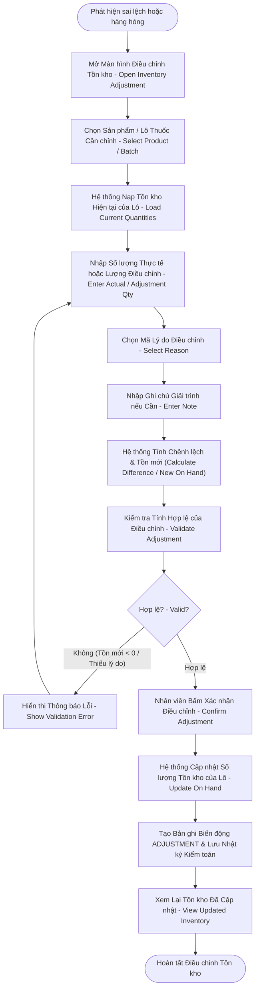

# ĐẶC TẢ LUỒNG HOẠT ĐỘNG SWL 2.6: ĐIỀU CHỈNH TỒN KHO
## (INVENTORY ADJUSTMENT WORKFLOW — BF-06)

> **Dự án:** PharmaFlow — Hệ thống Quản lý Kho & Bán hàng Thông minh cho Nhà thuốc Tư nhân  
> **Mã luồng:** `SWL-2.6` | **Mã tiến trình Draw.io:** `2.6` (`BF-06 Inventory Adjustment`)  
> **Phân hệ:** Quản trị Kho Dược & Cân đối Hao hụt (Inventory Control & Loss Management)  
> **Mã tài liệu:** `02_Requirement/7mainflow/Description SWL 6.md`  
> **Phiên bản:** v1.0 | **Ngày ban hành:** 13/10/2026  

---

## 1. TỔNG QUAN NGHIỆP VỤ (BUSINESS OVERVIEW)

### 1.1. Mục tiêu & Ý nghĩa
Luồng **SWL 2.6 (BF-06)** xử lý các tình huống phát sinh sai lệch đột xuất giữa tồn kho sổ sách trên hệ thống và số lượng thuốc thực tế tại tủ/kệ mà không cần phải chờ đến đợt kiểm kê định kỳ toàn diện:
- Xử lý các biến cố hao hụt vật lý: thuốc bị vỡ chai siro, chuột bọ cắn rách vỉ thuốc, đổ vỡ trong quá trình vận chuyển nội bộ.
- Xử lý thuốc mẫu thử nghiệm (Sample), thuốc đem đi kiểm nghiệm định kỳ theo yêu cầu của cơ quan y tế.
- Bù trừ sai số đếm lẻ khi bán cắt liều tại quầy.
- Quy trình bắt buộc ghi nhận lý do rõ ràng, tính toán tự động số lượng chênh lệch ($\Delta Q = Q_{\text{thực tế}} - Q_{\text{hệ thống}}$), ngăn chặn tình trạng tồn kho âm và lưu vết kiểm toán chặt chẽ để chống gian lận nội bộ.

### 1.2. Phạm vi & Tác nhân tham gia
- **Nhân viên có thẩm quyền / Chủ nhà thuốc (Authorized Staff / Owner-Admin):** Mở giao diện điều chỉnh kho, chọn thuốc và số lô cụ thể, nhập số lượng thực tế kiểm đếm được, chọn mã lý do và ghi chú giải trình.
- **Hệ thống PharmaFlow (System):** Nạp tồn kho hiện tại, tính toán số chênh lệch, kiểm tra tính hợp lệ (không để tồn âm), cập nhật lại số lượng `on_hand_quantity` của lô, tạo bản ghi biến động kho loại `ADJUSTMENT` và lưu vết kiểm toán.

### 1.3. Căn cứ pháp lý & Quy tắc nghiệp vụ (Business Rules)
- **BR16 (Nghiêm cấm tồn kho âm):** Số lượng sau điều chỉnh (`new_on_hand`) tuyệt đối không được $< 0$.
- **Lý do bắt buộc:** Mọi phiếu điều chỉnh bắt buộc phải chọn mã lý do hợp lệ: `DAMAGED` (Hư hỏng), `EXPIRED` (Hết hạn), `SAMPLE` (Mẫu thử), `COUNT_ERROR` (Sai số kiểm đếm), `LOST` (Thất thoát).
- **Phân quyền thao tác (RBAC):** Chỉ `ADMIN` hoặc nhân viên được ủy quyền mới có quyền tạo và duyệt phiếu điều chỉnh kho; nhân viên bán hàng thông thường không được tự ý sửa tồn.
- **Audit Trail:** Lưu vết đầy đủ: `User_ID`, `Batch_ID`, `Old_Qty`, `New_Qty`, `Diff_Qty`, `Reason`, `Timestamp`.

---

## 2. SƠ ĐỒ TIẾN TRÌNH HOẠT ĐỘNG (WORKFLOW DIAGRAM)

*Sơ đồ ánh xạ trực tiếp từ trang `2.6` trong tệp thiết kế `pharma.drawio`:*



---

## 3. BẢNG KỊCH BẢN THỰC THI TỪNG BƯỚC (STEP-BY-STEP SCENARIO TABLE)

| Bước | Tác nhân | Hành động & Thao tác Giao diện | Xử lý Hệ thống & Logic Backend | Ràng buộc (BR) | Kết quả đầu ra |
|:---:|:---|:---|:---|:---:|:---|
| **1** | Nhân viên | Mở màn hình danh sách điều chỉnh kho (`admin/inventory-adjustments.jsp`) | `InventoryAdjustmentServlet` (GET): Nạp lịch sử các đợt điều chỉnh trước đó | — | Hiển thị bảng lịch sử điều chỉnh kho |
| **2** | Nhân viên | Nhấn nút **"+ Tạo phiếu điều chỉnh"** (`admin/inventory-adjustment-form.jsp`) | Nạp danh sách các sản phẩm đang quản lý trong kho | — | Mở form nhập liệu điều chỉnh |
| **3** | Nhân viên | Tìm và chọn Sản phẩm, sau đó chọn đúng Số lô (`Batch No`) phát sinh sai lệch | Hệ thống tự động truy vấn và hiển thị: `Tồn kho sổ sách hiện tại (System Qty)` của lô đó | — | Nhân viên biết số lượng hiện có trên sổ |
| **4** | Nhân viên | Nhập **Số lượng thực tế (Actual Quantity)** đếm được tại kệ (hoặc số lượng hao hụt) | Tự động tính chênh lệch: $\Delta Q = Q_{\text{thực tế}} - Q_{\text{sổ sách}}$ | — | Hiển thị số chênh lệch (âm hoặc dương) |
| **5** | Nhân viên | Chọn **Lý do điều chỉnh** từ danh mục quy chuẩn | Dropdown danh mục lý do: Hỏng bao bì, Hết hạn sử dụng, Rơi vỡ, Sai số bán lẻ, Khác | Bắt buộc | Xác định nguyên nhân hao hụt |
| **6** | Nhân viên | Nhập ghi chú chi tiết: miêu tả cụ thể sự việc (ví dụ: "Vỡ 1 chai siro trong khi lau kệ") | Validate trường ghi chú không để trống nếu lý do là "Khác" | Audit | Bổ sung căn cứ kiểm tra sau này |
| **7** | Hệ thống | Kiểm tra tính hợp lệ của số liệu (Validate Adjustment) | - Kiểm tra: $Q_{\text{thực tế}} \ge 0$.<br/>- Kiểm tra: Người thực hiện có quyền `ADMIN` hoặc được ủy quyền. | BR16, RBAC | Chặn nếu số lượng thực tế nhập vào là số âm |
| **8** | Nhân viên | Rà soát số liệu và nhấn nút **"Xác nhận Điều chỉnh"** | `InventoryAdjustmentServlet` (POST): Bắt đầu mở Transaction cơ sở dữ liệu `connection.setAutoCommit(false)` | — | Bắt đầu lưu trữ giao dịch |
| **9** | Hệ thống | Cập nhật số lượng tồn kho `on_hand_quantity` của lô | `UPDATE inventory_batches SET on_hand_quantity = ? WHERE id = ?` | BR16 | Tồn kho thực tế của lô được cập nhật tức thì |
| **10** | Hệ thống | Tạo bản ghi phiếu điều chỉnh trong bảng `inventory_adjustments` | Insert: `batch_id`, `old_quantity`, `new_quantity`, `difference`, `reason`, `user_id`, `created_at` | Audit Trail | Ghi nhận chứng từ kế toán kho |
| **11** | Hệ thống | Ghi nhật ký biến động kho (`inventory_movements`) | Insert: `movement_type = 'ADJUSTMENT'`, `quantity = difference`, `batch_id`, `reference_id = adjustment_id` | Audit Trail | Đảm bảo tính liền mạch của chuỗi xuất/nhập/tồn |
| **12** | Hệ thống | Commit transaction & Chuyển hướng về màn hình danh sách | Thông báo: "Điều chỉnh tồn kho lô [Số lô] thành công. Tồn kho mới: [Số lượng]" | — | Màn hình cập nhật tồn kho mới nhất |

---

## 4. ÁNH XẠ GIAO DIỆN & LUỒNG MÀN HÌNH (UI/UX SCREEN FLOW)

### 4.1. Màn hình liên quan
- **`SCR_ADM_ADJUSTMENT_LIST` (`admin/inventory-adjustments.jsp`):** Danh sách các phiếu điều chỉnh tồn kho, cột thể hiện số chênh lệch màu đỏ (giảm) hoặc xanh (tăng).
- **`SCR_ADM_ADJUSTMENT_FORM` (`admin/inventory-adjustment-form.jsp`):** Form chọn sản phẩm, chọn lô, nhập số lượng thực tế, chọn lý do, nhập ghi chú giải trình.

### 4.2. Các phần tử tương tác quan trọng
- **Ô nhập số lượng thực tế (Actual Qty):** Tự động tính nhẩm ngay số chênh lệch ($\Delta Q$) bên cạnh:
  - Nếu giảm tồn kho: hiển thị `-X` màu đỏ cảnh báo.
  - Nếu tăng tồn kho: hiển thị `+X` màu xanh dương.
- **Bộ chọn lý do (Reason Select):**
  - Bắt buộc phải chọn 1 trong các lý do hệ thống định nghĩa sẵn.

---

## 5. ĐẶC TẢ KỸ THUẬT & SOURCE CODE MAPPING

### 5.1. Controller & Backend Handling
- **Controller chính:** `src/java/controller/InventoryAdjustmentServlet.java`.
- **Luồng xử lý POST điều chỉnh tồn kho (`handleCreateAdjustment`):**
  ```java
  int batchId = Integer.parseInt(request.getParameter("batchId"));
  int actualQty = Integer.parseInt(request.getParameter("actualQuantity"));
  String reason = request.getParameter("reason");
  String note = request.getParameter("note");
  int userId = ((User) session.getAttribute("user")).getId();

  if (actualQty < 0) {
      throw new IllegalArgumentException("Số lượng thực tế không được âm (BR16)");
  }

  Connection conn = DBContext.getConnection();
  try {
      conn.setAutoCommit(false);
      InventoryBatch batch = batchDAO.getBatchById(conn, batchId);
      int oldQty = batch.getOnHandQuantity();
      int difference = actualQty - oldQty;

      // 1. Cập nhật tồn kho lô mới
      batchDAO.updateQuantity(conn, batchId, actualQty);

      // 2. Tạo bản ghi điều chỉnh
      int adjId = adjustmentDAO.createAdjustment(conn, batchId, oldQty, actualQty, difference, reason, note, userId);

      // 3. Ghi biến động kho
      movementDAO.recordMovement(conn, batchId, "ADJUSTMENT", difference, adjId);

      conn.commit();
  } catch (Exception e) {
      conn.rollback();
  }
  ```

### 5.2. Bảng cơ sở dữ liệu tác động
- `inventory_adjustments`: `id`, `batch_id`, `old_quantity`, `new_quantity`, `difference`, `reason`, `note`, `user_id`, `created_at`.
- `inventory_batches`: Cập nhật `on_hand_quantity`.
- `inventory_movements`: Ghi mới dòng loại `ADJUSTMENT`.

---

## 6. LUỒNG NGOẠI LỆ & RỦI RO (ALTERNATIVE & EXCEPTION FLOWS)

| Mã ngoại lệ | Tình huống phát sinh | Cách xử lý hệ thống |
|:---:|:---|:---|
| **EX-2.6.1** | Nhân viên nhập số lượng thực tế là số âm (ví dụ: `-5`) | Validation trên Client và Server chặn ngay lập tức: *"Số lượng tồn kho thực tế phải $\ge 0$ (Quy tắc BR16)"*. Khóa nút submit. |
| **EX-2.6.2** | Số lượng chênh lệch giảm vượt quá 20% tổng tồn kho của lô | Hệ thống hiển thị cảnh báo mức độ cao (High Discrepancy Warning): *"Sai lệch giảm lớn (>20%). Thao tác này sẽ được ghi nhận vào báo cáo tài chính hao hụt bất thường của Ban Giám đốc"*. Yêu cầu Dược sĩ nhập giải trình chi tiết. |
| **EX-2.6.3** | Lô thuốc đang bị khóa (`BLOCKED`) có điều chỉnh được không? | Vẫn cho phép điều chỉnh nếu lý do là tiêu hủy thuốc hỏng trong lô bị khóa; ghi nhận rõ trạng thái trong nhật ký. |

---

## 7. TIÊU CHÍ NGHIỆM THU (ACCEPTANCE CRITERIA)
- [x] Hệ thống tự động tính chính xác số chênh lệch ($\Delta Q$) giữa thực tế và sổ sách.
- [x] Chặn tuyệt đối không cho phép lưu nếu số lượng tồn mới $< 0$.
- [x] Bắt buộc phải có lý do điều chỉnh hợp lệ mới cho phép xác nhận.
- [x] Tồn kho của lô thuốc được cập nhật ngay lập tức và lưu vết đầy đủ trong bảng `inventory_movements` và `inventory_adjustments`.
