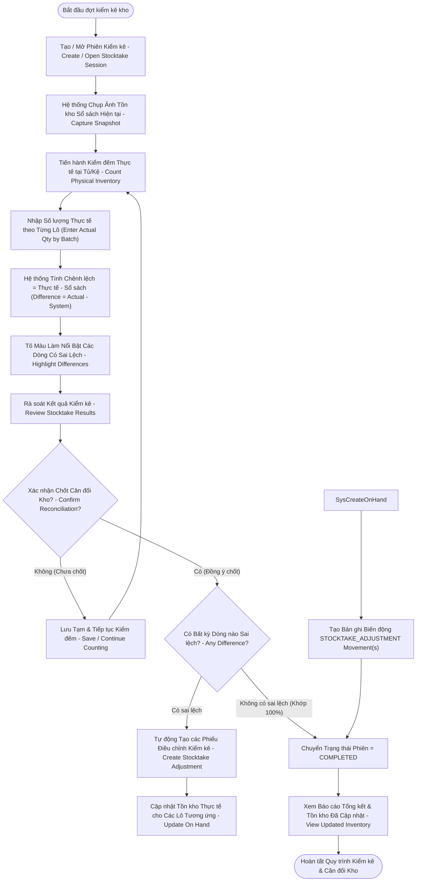

# ĐẶC TẢ LUỒNG HOẠT ĐỘNG SWL 2.7: KIỂM KÊ & CÂN ĐỐI KHO
## (STOCKTAKE & RECONCILIATION WORKFLOW — BF-07)

> **Dự án:** PharmaFlow — Hệ thống Quản lý Kho & Bán hàng Thông minh cho Nhà thuốc Tư nhân  
> **Mã luồng:** `SWL-2.7` | **Mã tiến trình Draw.io:** `2.7` (`BF-07 Stocktake & Reconciliation`)  
> **Phân hệ:** Quản trị Kho Dược & Kiểm kê Định kỳ (Periodic Physical Inventory & Auditing)  
> **Mã tài liệu:** `02_Requirement/7mainflow/Description SWL 7.md`  
> **Phiên bản:** v1.0 | **Ngày ban hành:** 13/10/2026  

---

## 1. TỔNG QUAN NGHIỆP VỤ (BUSINESS OVERVIEW)

### 1.1. Mục tiêu & Ý nghĩa
Luồng **SWL 2.7 (BF-07)** quản lý toàn diện quy trình kiểm kê kho định kỳ (hàng tuần, hàng tháng hoặc đột xuất) của nhà thuốc theo tiêu chuẩn Thực hành tốt Nhà thuốc (GPP):
- Khởi tạo phiên kiểm kê (Stocktake Session) và tự động chụp lại ảnh chụp nhanh tồn kho sổ sách (**Snapshot**) tại thời điểm bắt đầu để làm mốc đối chiếu chuẩn.
- Hỗ trợ nhân viên đi đếm thực tế từng tủ thuốc, quét mã vạch hoặc nhập số lượng đếm được theo từng số lô cụ thể.
- Hệ thống tự động so khớp và làm nổi bật các dòng có sai lệch (Thừa / Thiếu).
- Cho phép lưu tạm để tiếp tục đếm hoặc chốt cân đối (Reconciliation).
- Khi xác nhận cân đối: hệ thống tự động sinh ra các giao dịch điều chỉnh cân đối kho (`STOCKTAKE_ADJUSTMENT`), cập nhật lại tồn kho thực tế, khóa phiên kiểm kê và tạo báo cáo kiểm kê chi tiết phục vụ cơ quan quản lý và kiểm toán tài chính.

### 1.2. Phạm vi & Tác nhân tham gia
- **Nhân viên kiểm kê / Dược sĩ / Chủ nhà thuốc (Authorized Staff / Owner-Admin):** Tạo phiên kiểm kê, tiến hành đếm hàng thực tế tại kệ, nhập số lượng đếm theo từng lô, rà soát bảng sai lệch và xác nhận chốt cân đối kho.
- **Hệ thống PharmaFlow (System):** Chụp snapshot tồn kho, tính chênh lệch ($\text{Difference} = \text{Actual} - \text{System}$), tô màu làm nổi bật các dòng lệch, tạo các bút toán điều chỉnh tự động và hoàn tất phiên kiểm kê.

### 1.3. Căn cứ pháp lý & Quy tắc nghiệp vụ (Business Rules)
- **Quy định Kiểm kê GPP (Thông tư 02/2018/TT-BYT):** Nhà thuốc bắt buộc phải kiểm kê định kỳ tối thiểu mỗi tháng một lần để phát hiện thuốc quá hạn, thuốc hỏng và hao hụt.
- **Snapshot Immutability (Bất biến ảnh chụp tồn kho):** Số lượng sổ sách trong phiên kiểm kê được cố định tại thời điểm mở phiên, không bị thay đổi bởi các giao dịch phát sinh sau đó để đảm bảo tính khách quan của phép đối soát.
- **BR16 (Cấm tồn kho âm):** Số lượng thực tế nhập vào cho từng lô bắt buộc phải $\ge 0$.
- **Cân đối Tự động & Nhật ký Biến động:** Mọi sai lệch phát sinh khi chốt kiểm kê bắt buộc tự động tạo bản ghi biến động loại `STOCKTAKE_ADJUSTMENT`.

---

## 2. SƠ ĐỒ TIẾN TRÌNH HOẠT ĐỘNG (WORKFLOW DIAGRAM)

*Sơ đồ ánh xạ trực tiếp từ trang `2.7` trong tệp thiết kế `pharma.drawio`:*



---

## 3. BẢNG KỊCH BẢN THỰC THI TỪNG BƯỚC (STEP-BY-STEP SCENARIO TABLE)

| Bước | Tác nhân | Hành động & Thao tác Giao diện | Xử lý Hệ thống & Logic Backend | Ràng buộc (BR) | Kết quả đầu ra |
|:---:|:---|:---|:---|:---:|:---|
| **1** | Dược sĩ / Admin | Mở màn hình danh sách kiểm kê (`admin/stocktake-list.jsp`) | `StocktakeServlet` (GET): Nạp danh sách các phiên kiểm kê trong quá khứ và phiên đang mở | — | Hiển thị danh sách các đợt kiểm kê |
| **2** | Dược sĩ / Admin | Nhấn nút **"+ Tạo phiên kiểm kê mới"** | Nhập tên đợt kiểm kê (ví dụ: "Kiểm kê định kỳ Tháng 10/2026"), chọn phạm vi (Toàn bộ kho / Nhóm thuốc) | RBAC | Chuẩn bị khởi tạo phiên |
| **3** | Hệ thống | Khởi tạo phiên kiểm kê & Chụp ảnh tồn kho (Capture Snapshot) | Insert bảng `stocktakes` (`status = 'IN_PROGRESS'`). Copy toàn bộ số lượng `on_hand_quantity` của từng lô vào cột `snapshot_quantity` trong `stocktake_items` | Snapshot Immutability | Cố định số liệu sổ sách làm mốc so sánh chuẩn |
| **4** | Nhân viên | Cầm máy tính bảng hoặc danh sách in giấy, tiến hành đếm thực tế thuốc trên từng kệ | Thao tác vật lý: đếm số hộp, số vỉ của từng số lô cụ thể | GPP | Có số liệu đếm thực tế |
| **5** | Nhân viên | Nhập số lượng thực tế đếm được vào từng dòng lô thuốc trên giao diện (`admin/stocktake-detail.jsp`) | Nhập `actual_quantity`. Hệ thống tự động tính toán chênh lệch: $\text{Difference} = \text{Actual} - \text{Snapshot}$ | BR16 | Cột chênh lệch được cập nhật thời gian thực |
| **6** | Hệ thống | Tự động làm nổi bật các dòng thuốc có chênh lệch | - Dòng khớp ($\Delta = 0$): Màu trắng/xanh nhạt bình thường.<br/>- Dòng thiếu ($\Delta < 0$): Nền đỏ nhạt, chữ đỏ đậm.<br/>- Dòng thừa ($\Delta > 0$): Nền vàng nhạt, chữ xanh đậm. | UI UX | Nhân viên dễ dàng tập trung vào các mặt hàng có nghi vấn |
| **7** | Nhân viên | Rà soát các dòng có sai lệch lớn: có thể đếm lại để xác nhận số liệu | Nếu phát hiện đếm nhầm $\rightarrow$ sửa lại số lượng thực tế; nếu chưa đếm xong $\rightarrow$ nhấn **"Lưu tạm"** | — | Cho phép kiểm kê nhiều ngày không mất dữ liệu |
| **8** | Dược sĩ / Admin | Sau khi đếm xong toàn bộ, nhấn nút **"Chốt cân đối kho"** (Reconcile) | Hiển thị modal cảnh báo tóm tắt: Tổng số mặt hàng kiểm đếm, số dòng thừa, số dòng thiếu, tổng giá trị chênh lệch tiền | — | Xác nhận trách nhiệm của Trưởng ca kiểm kê |
| **9** | Hệ thống | Kiểm tra xem có dòng nào có sai lệch không ($\Delta \neq 0$) | - Nếu không có sai lệch: Chuyển ngay sang Bước 13.<br/>- Nếu có sai lệch: Tiến hành quy trình cân đối tự động. | — | Rẽ nhánh xử lý |
| **10** | Hệ thống | Tự động cập nhật lại tồn kho của các lô có sai lệch | Cập nhật `inventory_batches`: gán `on_hand_quantity = actual_quantity` | BR16 | Tồn kho thực tế và sổ sách trở nên đồng nhất |
| **11** | Hệ thống | Tự động ghi nhật ký biến động kho cân đối (`STOCKTAKE_ADJUSTMENT`) | Insert `inventory_movements`: `movement_type = 'STOCKTAKE_ADJUSTMENT'`, `quantity = difference`, `batch_id`, `reference_id = stocktake_id` | Audit Trail | Lưu vết đầy đủ cho từng lô có biến động |
| **12** | Hệ thống | Khóa phiên kiểm kê: Chuyển trạng thái sang `COMPLETED` | Cập nhật `stocktakes`: `status = 'COMPLETED'`, ghi nhận thời gian kết thúc và người phê duyệt | — | Phiên kiểm kê bị đóng băng, không thể chỉnh sửa |
| **13** | Hệ thống | Hiển thị Báo cáo tổng kết kiểm kê hoàn tất | Hiển thị bảng tổng kết sai lệch, tỷ lệ chính xác tồn kho, xuất file báo cáo phục vụ kiểm toán | — | Hoàn tất đợt kiểm kê thành công |

---

## 4. ÁNH XẠ GIAO DIỆN & LUỒNG MÀN HÌNH (UI/UX SCREEN FLOW)

### 4.1. Màn hình liên quan
- **`SCR_ADM_STOCKTAKE_LIST` (`admin/stocktake-list.jsp`):** Danh sách các đợt kiểm kê, trạng thái `Đang đếm` (In Progress) hoặc `Đã hoàn tất` (Completed).
- **`SCR_ADM_STOCKTAKE_DETAIL` (`admin/stocktake-detail.jsp`):** Bảng kiểm kê chi tiết gồm các cột: Tên thuốc, Số lô, Hạn dùng, Tồn sổ sách (Snapshot), Thực tế đếm, Chênh lệch, Nút lưu tạm, Nút chốt cân đối.
- **`MODAL_CONFIRM_RECONCILIATION`:** Popup cảnh báo tổng kết sai lệch giá trị tiền và yêu cầu mật khẩu Admin xác nhận chốt kho.

### 4.2. Các phần tử tương tác quan trọng
- **Thanh tiến độ kiểm đếm (Progress Bar):** Thể hiện phần trăm số lô đã được nhập số lượng đếm thực tế (ví dụ: `Đã đếm 85/100 lô (85%)`).
- **Bộ lọc nhanh sai lệch:** Nút lọc "Chỉ xem các dòng có chênh lệch" giúp Dược sĩ nhanh chóng đối chiếu các lô bị lệch số lượng mà không phải cuộn trang dài.

---

## 5. ĐẶC TẢ KỸ THUẬT & SOURCE CODE MAPPING

### 5.1. Controller & Backend Handling
- **Controller chính:** `src/java/controller/StocktakeServlet.java`.
- **Luồng xử lý POST chốt cân đối kho (`handleReconcile`):**
  ```java
  int stocktakeId = Integer.parseInt(request.getParameter("stocktakeId"));
  int userId = ((User) session.getAttribute("user")).getId();

  Connection conn = DBContext.getConnection();
  try {
      conn.setAutoCommit(false);
      List<StocktakeItem> items = stocktakeDAO.getItemsByStocktakeId(conn, stocktakeId);
      
      for (StocktakeItem item : items) {
          int diff = item.getActualQuantity() - item.getSnapshotQuantity();
          if (diff != 0) {
              // 1. Cập nhật tồn kho thực tế của lô
              batchDAO.updateQuantity(conn, item.getBatchId(), item.getActualQuantity());
              
              // 2. Ghi biến động kho cân đối kiểm kê
              movementDAO.recordMovement(conn, item.getBatchId(), "STOCKTAKE_ADJUSTMENT", diff, stocktakeId);
          }
      }
      
      // 3. Khóa phiên kiểm kê
      stocktakeDAO.updateStatus(conn, stocktakeId, "COMPLETED", userId);
      conn.commit();
  } catch (Exception e) {
      conn.rollback();
  }
  ```

### 5.2. Bảng cơ sở dữ liệu tác động
- `stocktakes`: `id`, `name`, `status` (`IN_PROGRESS`, `COMPLETED`), `created_by`, `completed_by`, `created_at`, `completed_at`.
- `stocktake_items`: `id`, `stocktake_id`, `product_id`, `batch_id`, `snapshot_quantity`, `actual_quantity`, `difference`.
- `inventory_batches`: Cập nhật `on_hand_quantity` theo `actual_quantity`.
- `inventory_movements`: Ghi mới các bản ghi biến động loại `STOCKTAKE_ADJUSTMENT`.

---

## 6. LUỒNG NGOẠI LỆ & RỦI RO (ALTERNATIVE & EXCEPTION FLOWS)

| Mã ngoại lệ | Tình huống phát sinh | Cách xử lý hệ thống |
|:---:|:---|:---|
| **EX-2.7.1** | Trong lúc đang mở phiên kiểm kê, quầy POS vẫn bán hàng làm tồn kho thực tế bị trừ | Do hệ thống sử dụng cơ chế **Snapshot** tại thời điểm mở phiên, số lượng sổ sách để so sánh vẫn được giữ nguyên. Hệ thống khuyến cáo: Nên thực hiện kiểm kê ngoài giờ mở cửa hoặc tạm ngừng phiên bán để tránh lệch số liệu. |
| **EX-2.7.2** | Phát hiện có thuốc tại kệ nhưng không tìm thấy số lô trong danh sách kiểm kê | Cho phép nhân viên bấm nút **"+ Thêm lô ngoài danh sách"**, nhập số lô mới và HSD thực tế; hệ thống ghi nhận lô này với `snapshot_quantity = 0` và `actual_quantity = số đếm`. |
| **EX-2.7.3** | Phiên kiểm kê bị bỏ quên quá 7 ngày không chốt | Hệ thống gửi cảnh báo tới Admin: *"Phiên kiểm kê [Tên phiên] đã quá 7 ngày chưa hoàn tất. Vui lòng hoàn tất hoặc hủy phiên để đảm bảo tính thời sự của tồn kho"*. |

---

## 7. TIÊU CHÍ NGHIỆM THU (ACCEPTANCE CRITERIA)
- [x] Phiếu kiểm kê chụp chính xác ảnh snapshot số lượng tồn kho của toàn bộ các lô tại thời điểm mở phiên.
- [x] Hệ thống tự động tính toán chênh lệch và tô màu nổi bật các dòng thừa/thiếu.
- [x] Cho phép lưu tạm nhiều lần trong quá trình đếm.
- [x] Khi chốt cân đối, tồn kho của các lô bị lệch được cập nhật chuẩn xác theo số thực tế và toàn bộ biến động `STOCKTAKE_ADJUSTMENT` được ghi lại đầy đủ.
- [x] Phiên kiểm kê sau khi hoàn tất được chuyển sang trạng thái `COMPLETED` và đóng băng dữ liệu.
